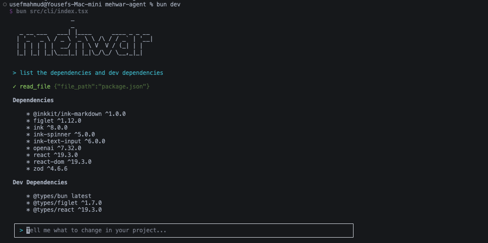

# mehwar
A small TypeScript agent.

### Project structure:

```
src/
├── core/        # currently contains shared types: Message, ContentBlock, AgentEvent
├── providers/   # LLMProvider interface and the OpenAI-compatible provider
├── tools/       # tool registry and built-in tools
└── agent/       # the main agent loop
```

<div style="background:grey; padding: 1px; border-radius: 5px; line-height:0px;">

</div>